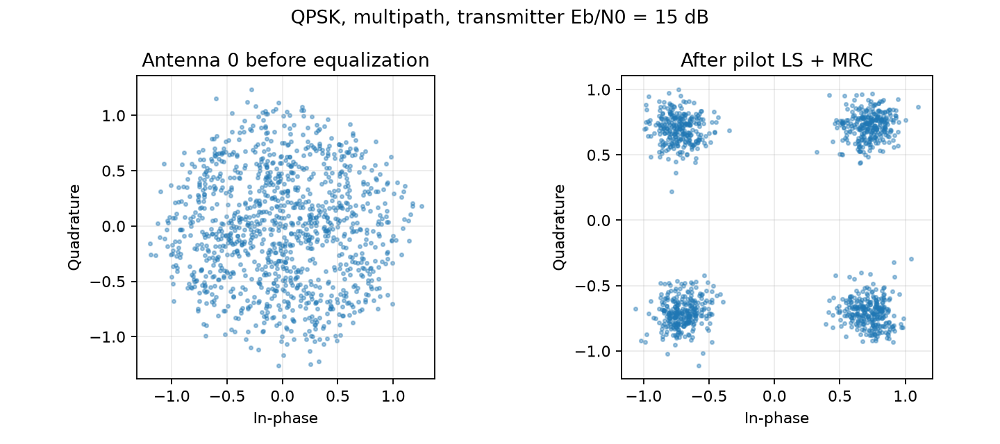
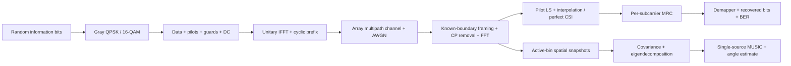
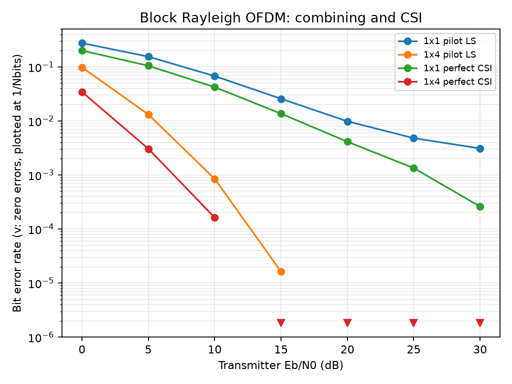
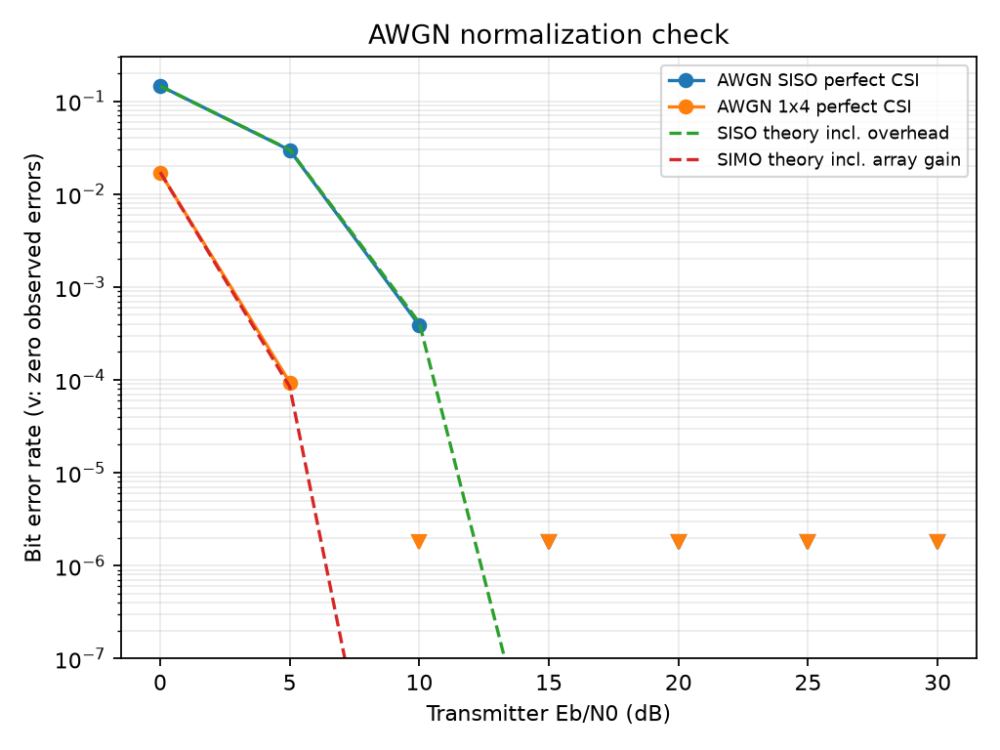
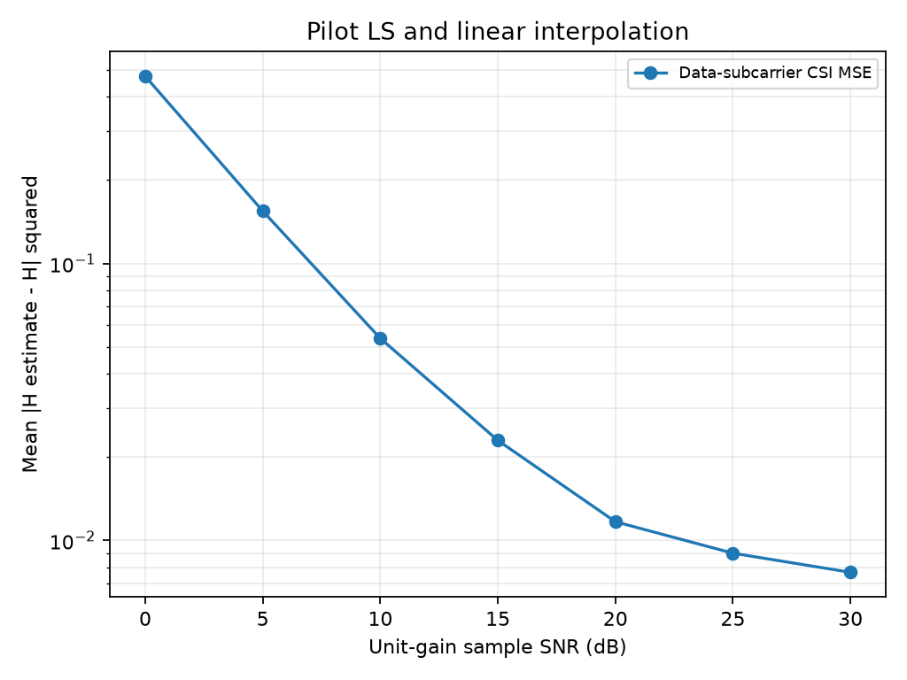
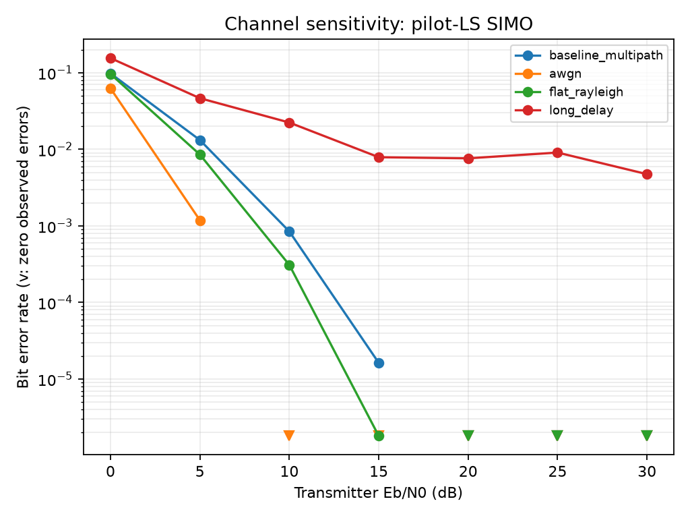
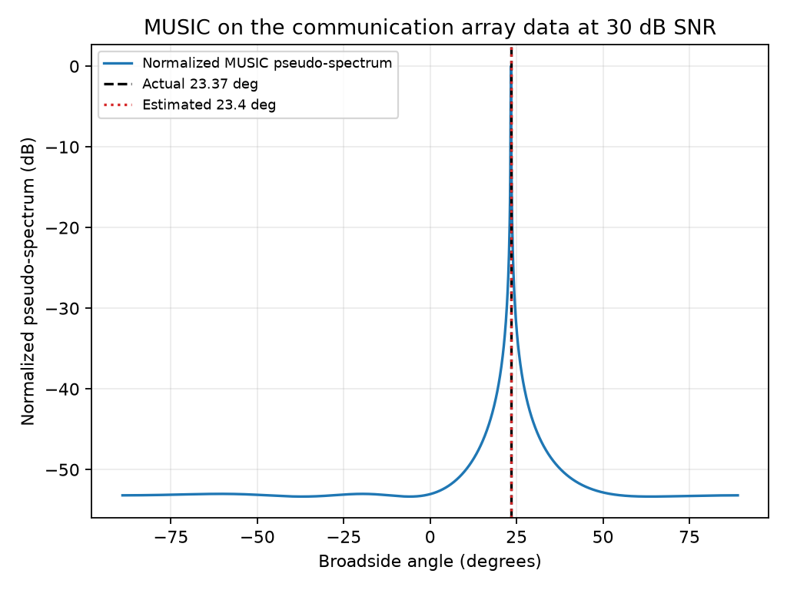
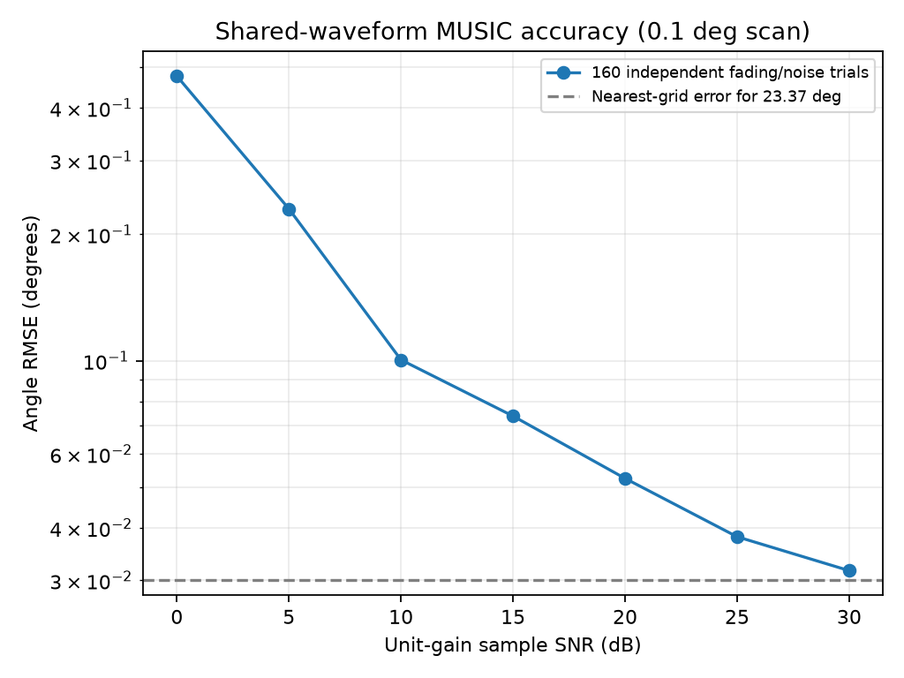

# SIMO OFDM Receiver with Shared-Waveform Direction Finding

An executable Python simulation of a **1×4 OFDM communication receiver and MUSIC direction-of-arrival estimator**. Random information bits pass through a time-domain multipath channel, then return through pilot-assisted channel estimation, antenna combining and bit decisions. In the sensing experiment, MUSIC operates on the **same received array samples** used to recover the bits.




## Why this project

Reliable multicarrier reception and array processing are relevant to aerospace telemetry, airborne links and ground-station receivers. This project develops the underlying skills: waveform generation, CSI estimation, diversity combining, noise calibration and direction finding. It does not claim an aerospace-standard waveform, a validated flight channel or radar range/velocity estimation.

## Architecture



The independent-branch Rayleigh model tests **communication diversity**. A separate, explicitly spatial channel with one shared arrival angle tests **communication and sensing together**. Its multiple delay taps share the same steering vector; it supplies coherent array gain, not independent branch diversity.

## Quick start

Python **3.11+** is required. From the repository root:

```bash
python -m venv .venv
# Linux/macOS
source .venv/bin/activate
# Windows PowerShell: .\.venv\Scripts\Activate.ps1
python -m pip install -e ".[dev]"
python -m pytest -q
ofdm-isac --config configs/baseline.yaml --output results
```

The final command runs **all seven figure-producing experiments**, writes raw metrics and prints measured BER/RMSE values. It uses 240 independent frames per communication point and 160 sensing trials per SNR. The checked-in run took about 85 seconds on the local environment; runtime varies by machine.

For a fast execution check, use a separate output directory:

```bash
ofdm-isac --frames 2 --trials 2 --step 15 --output results/smoke
```

This smoke run checks execution only; its sample counts are unsuitable for performance claims. The full suite can also be invoked with `python scripts/run_experiments.py` or `python -m ofdm_isac.evaluation.experiments` using the same flags.

## Implemented receiver

| Component | Implementation |
|---|---|
| Modulation | Gray QPSK and square 16-QAM, unit ensemble symbol energy |
| OFDM | Unitary FFT/IFFT, explicit CP and resource-grid allocation |
| Channels | Unit-gain AWGN, independent Rayleigh multipath, shared-angle ULA multipath |
| Framing | Known/perfect timing; optional known-boundary offset correction |
| CSI | Pilot LS, complex linear interpolation on each side of DC, perfect-CSI reference |
| Combining | Normalized single-stream maximum-ratio combining |
| Sensing | Shared-waveform spatial covariance, Hermitian eigendecomposition, one-source MUSIC |
| Evaluation | BER/error counts, frame-bootstrap intervals, CSI MSE, constellation, AoA RMSE |
| Impairments | Configurable common CFO and sample delay; separate oracle-correction example |

### Baseline configuration

Edit [`configs/baseline.yaml`](configs/baseline.yaml); invalid values and unknown keys are rejected.

| Parameter | Default |
|---|---|
| FFT / cyclic prefix | 64 / 16 samples |
| Information symbols per frame | 32 OFDM symbols |
| Modulation / array | QPSK / 1 transmit, 4 receive antennas |
| Active / pilot / data bins | 52 / 16 / 36 |
| Nulls | DC plus 11 guards |
| Delay taps / average tap powers | [0, 2, 4] samples / [0, −4, −8] dB, normalized total expected gain |
| Pilot placement | Every fourth active bin on each side of DC, plus both end bins |
| ULA spacing / baseline angle | 0.5 wavelengths / 23.4° from broadside |
| CFO / timing offset | 0 subcarrier spacings / 0 samples |
| Seed | 48, with independent deterministic experiment streams |
| Sweep | 0–30 dB in 5 dB steps |

The sensing sweep overrides the angle to **23.37°** (off the scan grid), uses eight symbols and scans −89° to +89° at 0.1° spacing. The long-delay stress test uses [0, 6, 12] samples. That experiment requires CP ≥12. The full suite requires at least two receive antennas and zero offsets.

### Mathematical model

$$x_m[n]=\frac{1}{\sqrt N}\sum_{k=0}^{N-1}X_m[k]e^{j2\pi kn/N},\qquad
y_r[n]=\sum_\ell h_r[\ell]x[n-\ell]+w_r[n].$$

For a block-static channel, zero CFO, correct timing and maximum delay ≤CP:

$$Y_r[m,k]=H_r[k]X_m[k]+W_r[m,k].$$

Waveform transforms use `norm="ortho"`; **H is the ordinary unnormalized DFT of the taps**. Pilot estimates are Hhat=Y/Xpilot followed by linear interpolation. The MRC output is

$$\hat X[m,k]=\frac{\sum_r\hat H_r^*[m,k]Y_r[m,k]}{\sum_r|\hat H_r[m,k]|^2+10^{-12}}.$$

The denominator floor prevents numerical division by zero. It is not an MMSE noise regularizer. A unit-symbol-energy LMMSE receiver would instead include the receiver noise variance in the denominator.

For a ULA along the x-axis with broadside angle theta:

$$a_r(\theta)=e^{-j2\pi r(d/\lambda)\sin\theta},\quad
\hat R=ZZ^H/K,\quad P(\theta)=\frac{1}{\|E_n^Ha(\theta)\|^2}.$$

The channel and MUSIC scan use the same negative phase sign. Z contains 416 active-bin FFT snapshots from the communication reception. There is one declared source and three noise-subspace eigenvectors for four antennas. See the [complete model and assumptions](docs/signal-model.md) for geometry, coherence, snapshot dependence and identifiability.

### SNR conventions

Eb/N0 means **expected total transmitter energy per information bit**, including pilot and prefix energy. With A active bins, D data bins, b modulation bits and CP length C:

$$E_{b,tx}=\frac{A+DC/N+E_{p,CP}}{Db},\qquad \sigma_w^2=E_{b,tx}\,10^{-E_b/N_0\text{(dB)}/10}.$$

Here E_p,CP is the exact CP energy of the pilot-only IFFT. Fixed +1 pilots combine coherently, so the usual A(1+C/N) approximation is not exact. For baseline QPSK, E_b,tx=64.34196177/72=0.89363836. Data-symbol Es=1, so Es/N0=1/noise variance. The overhead penalty relative to useful-data-only Eb/N0 is **2.5219 dB**. The AWGN QPSK reference includes this penalty and receive-array gain. CSI and sensing plots instead use **ensemble unit-gain sample SNR**: [64.34196177/(64+16)]/noise variance. Noise is never rescaled to compensate a sampled deep fade. The [derivation](docs/signal-model.md#noise-and-energy-conventions) gives all conversions.

## Measured results

Generated with `configs/baseline.yaml`, seed 48, **552,960 bits and 240 independent frames per communication point**. There are 15,482,880 transmitted information bits across the four seven-point communication scenarios, plus the separate sensing and CSI trials. All curves come from actual simulation; the dashed AWGN lines are explicitly labeled theoretical references.

| Transmit Eb/N0 | SISO pilot LS BER | SIMO pilot LS BER | SIMO perfect-CSI BER |
|---|---:|---:|---:|
| 0 dB | 0.27596 | 0.097929 | 0.034436 |
| 5 dB | 0.15491 | 0.013203 | 0.003056 |
| 10 dB | 0.067587 | **0.00084635** | 0.00016276 |
| 15 dB | 0.025727 | 0.00001628 | 0 observed errors |
| 20 dB | 0.009849 | 0 observed errors | 0 observed errors |
| 25 dB | 0.004803 | 0 observed errors | 0 observed errors |
| 30 dB | 0.003100 | 0 observed errors | 0 observed errors |

At 10 dB, pilot-LS SIMO recorded **468 errors in 552,960 bits**, versus **37,373** for SISO on antenna zero of the same observations. At 15 dB the nine SIMO errors occurred in only three frames, so that estimate is not a well-resolved rare-event rate.

**Zero observed errors do not establish zero BER.** Downward triangles mark zero-count points at 1/Nbits for visibility, not confidence bounds. JSON includes whole-frame bootstrap intervals and separately named iid-bit and independent-frame zero-event bounds. Bitwise independence does not hold under block fading. For 240 zero-error independent frames, the conservative 95% upper bound on frame-error probability is about 0.0124; substantially more independent fades are needed for strong low-BER claims.



The AWGN perfect-CSI run at 0 dB measured SISO BER **0.14568** and four-antenna BER **0.017097**. Dedicated tests compare independent-bit QPSK error counts to the overhead-corrected theoretical reference within six binomial standard errors.



CSI MSE falls from **0.47460 at 0 dB sample SNR** to **0.007663 at 30 dB**. The residual floor reflects linear interpolation bias. A sufficiently long CP prevents intersymbol interference; it does not guarantee that a sparse pilot grid resolves a rapidly varying frequency response. The [0,6,12]-sample stress channel visibly demonstrates that distinction.

| Pilot-LS SIMO channel at 10 dB Eb/N0 | Measured BER |
|---|---:|
| Unit-gain AWGN | 0 observed errors |
| Flat independent Rayleigh | 0.0003092 |
| Baseline [0,2,4] Rayleigh | 0.0008464 |
| Long-delay [0,6,12] Rayleigh | 0.02236 |




MUSIC uses the spatial channel, with **160 independent trials per SNR**. Angle RMSE is **0.4766° at 0 dB**, **0.1005° at 10 dB**, and **0.03162° at 30 dB** sample SNR. At high SNR the error approaches the 0.03° distance between the actual angle and the nearest scan point. Communication error counts from those same spatial receptions are also recorded in JSON.




### Reproduce each output

One complete command generates every result:

```bash
ofdm-isac --config configs/baseline.yaml --frames 240 --trials 160 --step 5 --output results
python scripts/impairments.py
```

| Experiment | Output |
|---|---|
| SISO vs SIMO, LS vs perfect CSI | `results/ber.png` |
| AWGN normalization vs theory | `results/awgn.png` |
| CSI MSE vs sample SNR | `results/channel_mse.png` |
| Before/after equalization | `results/constellation.png` |
| Shared-reception MUSIC spectrum | `results/music.png` |
| AoA RMSE vs sample SNR | `results/aoa_rmse.png` |
| Channel/delay-profile BER comparison | `results/channels.png` |
| Error counts, intervals, settings, trial angles | `results/metrics.json` |
| Example complex waveforms, grids, taps, CSI, MUSIC data | `results/example_arrays.npz` |

Each experiment is also a reusable Python function in [`experiments.py`](src/ofdm_isac/evaluation/experiments.py): `communication`, `channel_mse` and `sensing`. For a longer study, increase `--frames` and `--trials`. For 16-QAM, copy the YAML, set `modulation: 16QAM`, and pass that file with `--config`; the theoretical QPSK overlay is then omitted.

## Verification

**40 tests passed locally on Python 3.13.5.** The test suite checks all constellation labels and Gray neighbors; FFT/IFFT and prefix reconstruction; pilot/guard/DC allocation; noiseless QPSK and 16-QAM recovery in SISO/SIMO with all three channels; the time-domain convolution identity; known-channel interpolation; AWGN BER; Rayleigh diversity; MUSIC angle/sign and shared observations; deterministic seeds; invalid parameters; and oracle CFO/timing correction. Noiseless multipath bit recovery uses perfect CSI; flat-channel pilot-LS recovery is also verified. Linear interpolation is approximate for a frequency-selective channel.

```bash
python -m pytest -q
python -m pip check
```

GitHub Actions is configured to run tests and a small full-pipeline smoke experiment on Python 3.11 and 3.13. Remote CI status must be checked after publication; local success does not imply that hosted CI has run. See [validation notes](docs/validation.md) and the [tested environment lock](requirements-lock.txt).

## Repository layout

```text
src/ofdm_isac/
  transmitter/  # modulation, grid, IFFT, prefix
  channel/      # array channel, convolution, AWGN, offsets
  receiver/     # framing, FFT, pilot LS, MRC, demapping
  sensing/      # ULA covariance and single-source MUSIC
  evaluation/   # Monte Carlo experiments and plots
  utils/        # validated YAML configuration
configs/        # reproducible baseline
tests/          # numerical unit and integration checks
scripts/        # experiment entry point and offset demonstration
results/        # measured metrics, example arrays and seven figures
docs/           # equations, assumptions, validation and resume bullets
```

## Limitations and next steps

- Perfect baseline timing and block-static channels; no preamble acquisition or practical CFO tracking. Offset compensation is oracle-assisted.
- Uncoded hard decisions, no packet CRC, FEC, RF front end or hardware validation.
- Interpolation bias can dominate at high SNR, especially with long delays. A delay-domain LS/LMMSE estimator and pilot-design study are natural next steps.
- Conventional MUSIC is restricted to one far-field shared-angle source. Coherent paths arriving from distinct angles need spatial smoothing or a different model.
- No spatial calibration error, coupling, colored interference, beam squint or geometry-dependent fading correlation.
- No radar range, Doppler or velocity claims. This is communication plus passive direction finding on a shared waveform.
- Low-error fading points need more independent channel realizations; current curves demonstrate receiver behavior without certifying ultra-low BER.

Possible extensions include acquisition/tracking, path-dependent Doppler, correlated/Rician arrays, calibrated SDR measurements and joint delay-angle estimation. [Resume bullets grounded in the implementation](docs/resume.md) are included.

## References and license

The implementation uses [NumPy's documented unitary FFT mode](https://numpy.org/doc/stable/reference/generated/numpy.fft.fft.html). Background on [MUSIC covariance/subspace processing](https://www.mathworks.com/help/phased/ug/music-super-resolution-doa-estimation.html) and [coherent-source spatial smoothing](https://www.mathworks.com/help/phased/ref/spsmooth.html) informed the declared sensing assumptions. Equations and energy conversions are derived in [the signal-model document](docs/signal-model.md).

[MIT license](LICENSE).
